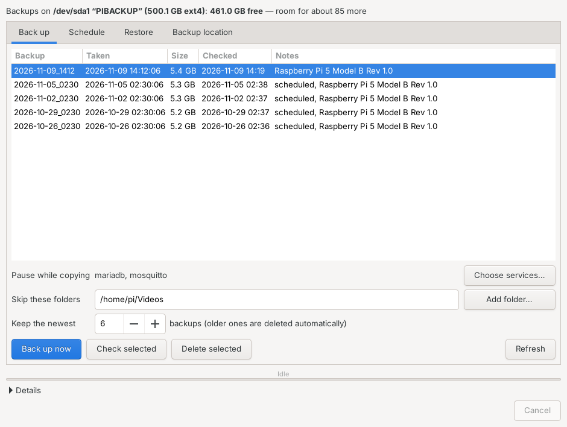
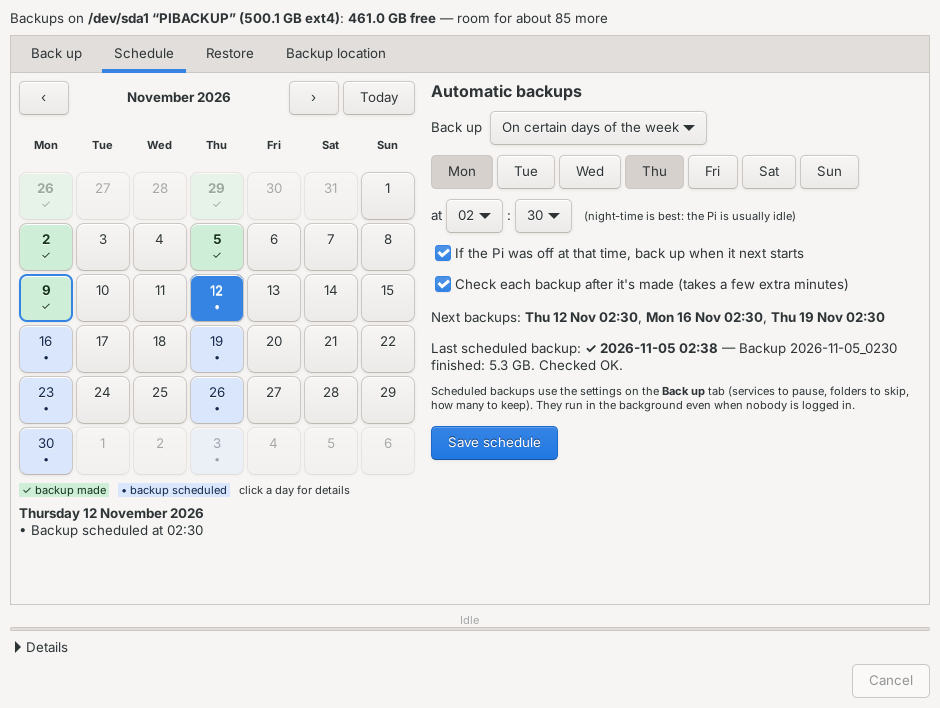
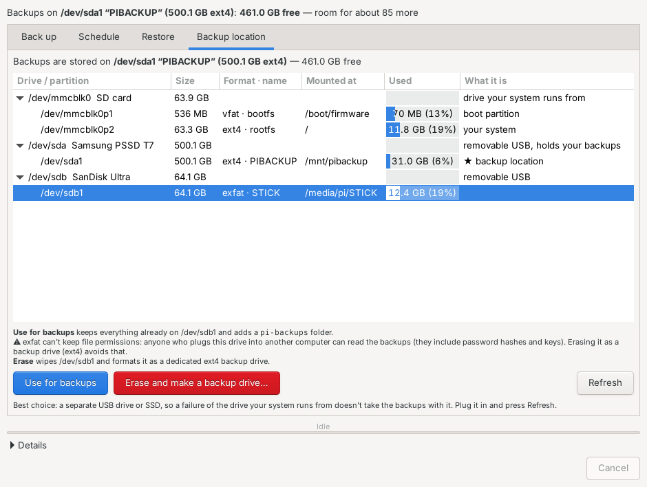
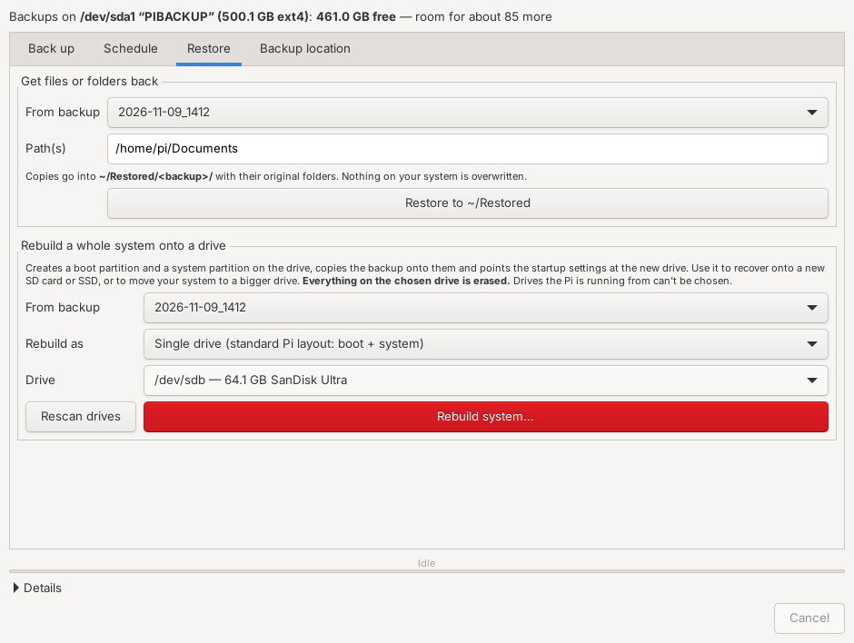
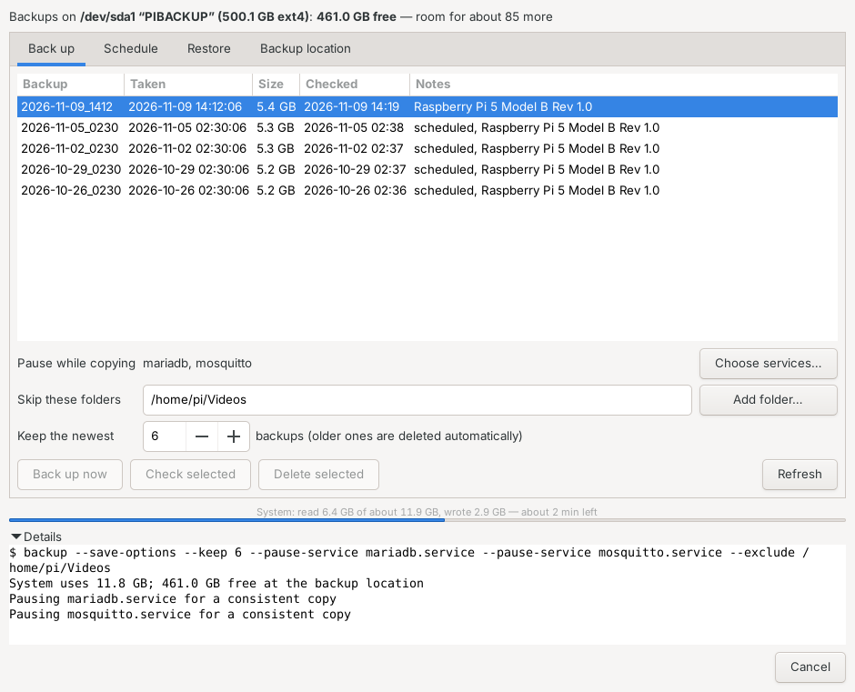
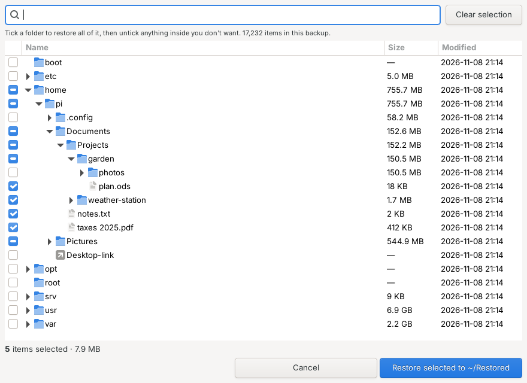
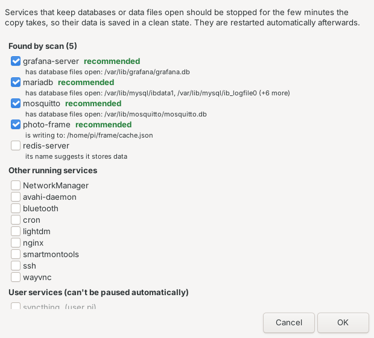

# Pi Backup Manager

**Version 1.3.0** · [Changelog](#changelog) · [Upgrade](#upgrade)

A simple desktop app for **compressed, restorable whole-system backups** of a Raspberry Pi,
with a **disk manager** for choosing where backups live and a **calendar scheduler** for
automatic backups.

Made for Raspberry Pi OS (Bookworm / Trixie) with the desktop, tested on a Raspberry Pi 5.
Works with an SD card, a USB or NVMe SSD, or two NVMe drives in a RAID1 mirror.

| Back up | Schedule |
|---|---|
|  |  |

| Backup location (disk manager) | Restore |
|---|---|
|  |  |



## What it does

- **Back up** the whole system (OS, apps, services, settings, home folders) into one
  compressed backup. Owners, permissions, ACLs and extended attributes are kept.
- **Backup location:** see every drive and partition, what it's used for and how full it is,
  then either *use* one (your files stay, backups go into a `pi-backups` folder) or *erase* it
  into a dedicated backup drive. Drives the Pi is running from are locked.
- **Schedule:** every day, on chosen weekdays, or once a month at a set time. A month
  calendar shows ✓ for backups made and • for backups coming up; click a day for details.
  Missed runs can catch up when the Pi next starts, and each scheduled backup can be checked
  automatically.
- **Check** any backup. Every piece is read back and compared with its checksum.
- **Browse a backup and pick what to get back:** a folder tree with checkboxes, search, sizes and
  dates. Tick a folder, untick anything inside it you don't need, then restore the selection into
  `~/Restored/<backup>/` without touching the live system.

  
- **Rebuild a whole system** onto a drive:
  - *Single drive:* creates the standard Pi boot and system partitions, unpacks the backup and
    points the startup settings at the new drive. Use it to recover onto a new SD card or SSD,
    or to move to a bigger drive.
  - *RAID1 mirror:* recreates a two-drive `mdadm` mirror with the original IDs, so the
    existing boot partition finds it unchanged.
- **Pause services** that hold databases (MariaDB, InfluxDB, Mosquitto and so on) for the
  few minutes the copy takes, then restart them. **Scan…** looks at the files each running
  service actually has open. It recommends the ones with database files open or data files
  being written, and shows why.

  
- **Keep the newest N** backups. Older ones are removed automatically, and early if space
  runs short.

## Install

```
git clone https://github.com/CharlesPhillips3/pi-backup-manager.git
cd pi-backup-manager
sudo bash install.sh
```

Or install it in one line, without keeping a copy of the repo:

```
curl -fsSL https://raw.githubusercontent.com/CharlesPhillips3/pi-backup-manager/main/upgrade.sh | sudo bash
```

The installer doesn't touch any drive. Open **Pi Backup Manager** from the menu
(System Tools), or run `pibackup`. Then:

1. **Backup location** tab: plug in a USB drive or SSD, press *Refresh*, select it, and choose
   *Use for backups* or *Erase and make a backup drive…*.
2. **Back up** tab: press *Scan…* to find services worth pausing, add any folders to skip, then *Back up now*.
3. **Schedule** tab: pick when, then *Save schedule*.

## Upgrade

Run the same line again. It fetches the latest version and reinstalls it; your settings,
schedule and backups are kept:

```
curl -fsSL https://raw.githubusercontent.com/CharlesPhillips3/pi-backup-manager/main/upgrade.sh | sudo bash
```

If you installed from a clone instead: `cd pi-backup-manager && git pull && sudo bash install.sh`.
The version you have is shown at the top right of the app, and by
`/opt/pibackup/pibackup-helper --version`.

## Where backups live

Each backup is a folder `backups/<date_time>/` at the backup location:

| File | What it is |
|---|---|
| `root.tar.zst.000`, `.001`, … | The system, as a zstd-compressed tar stream split into 3.9 GB pieces (so FAT32 drives work). |
| `boot.tar.zst.000` | The boot partition (`/boot/firmware`). |
| `manifest.json` | Date, settings, sizes, checksums, and the partition, filesystem and RAID IDs needed for a rebuild. |
| `SHA256SUMS` | Checksums of every piece (`sha256sum -c SHA256SUMS`). |
| `info/` | Disk layout, fstab, boot config, EEPROM config, package list (for reference). |

Left out automatically: temporary files, caches, the Trash, downloaded `.deb` files, and any
folders you add to *Skip these folders* (if Ollama is installed, its downloadable models are
suggested by default).

A copy of the app and this README is kept in `tools/` next to the backups, so you can
install it on a rescue system.

> **Privacy:** backups contain everything, including password hashes and SSH keys. On ext4,
> btrfs or xfs drives the archive files are readable only by root. FAT32, exFAT and NTFS
> can't store permissions, so anyone who plugs such a drive into another computer can read
> the backups. The app warns you about this.

## Scheduled backups

Saving a schedule creates a systemd timer (`pibackup-scheduled.timer`), so backups run even
when nobody is logged in. Scheduled runs use the settings from the *Back up* tab as they
were last saved (by *Back up now* or *Save schedule*). The result of the last scheduled run
is shown on the Schedule tab.

```
systemctl list-timers pibackup-scheduled.timer      # when it runs next
journalctl -u pibackup-scheduled.service             # what happened
```

## Restoring

### A few files

On the **Restore** tab, pick a backup and click **Browse backup…**. Tick the files and folders
you want (search helps in big backups), then click **Restore selected**. Copies appear in
`~/Restored/<backup>/…` with their original folders. You can also type full paths and use
*Restore typed path(s)*.

Every backup saves a list of its contents (`index.tsv.gz`), so browsing opens instantly. For
backups made before version 1.3.0 the list is built the first time you browse, which reads the
whole backup once.

### The whole system

The drive you rebuild onto is erased, and it can't be the drive the Pi is running from.

- **Moving to a new or bigger drive:** with the Pi running normally, connect the new drive
  (USB adapter or NVMe) and use *Rebuild as: Single drive*. Then shut down, remove the old
  drive (or change the boot order) and start up.
- **When the system drive has failed:**
  1. Use Raspberry Pi Imager to put Raspberry Pi OS onto a spare SD card or USB stick, and
     boot from it.
  2. Connect your backup drive, then run `sudo bash <backup drive>/tools/install.sh`
     (or `<backup drive>/pi-backups/tools/install.sh`).
  3. Open Pi Backup Manager. On the *Backup location* tab, select the backup drive and choose
     *Use for backups*. It keeps your existing backups.
  4. On the *Restore* tab, rebuild onto the replacement drive.
  5. Shut down, remove the rescue card or stick, and boot from the rebuilt drive.
- **RAID1 systems:** choose *Rebuild as: RAID1 mirror*, then the two drives. Only replace the
  boot partition if it's damaged. If only one drive of a mirror fails you don't need a
  restore; just add the new drive with `sudo mdadm --add /dev/md127 /dev/<new drive>`.

### By hand (without the app)

```
cat root.tar.zst.* | zstd -dc | sudo tar -x -C /some/folder --numeric-owner -p ./home/pi/Documents
# whole system onto an empty ext4 filesystem mounted at /mnt/t:
cat root.tar.zst.* | zstd -dc | sudo tar -x -C /mnt/t --numeric-owner -p --acls --xattrs --xattrs-include='*'
sudo mkdir -p /mnt/t/{proc,sys,dev,run,tmp,mnt,media,boot/firmware}
```

Then update `root=` in the boot partition's `cmdline.txt` and the `/` and `/boot/firmware`
lines in `/mnt/t/etc/fstab` to the new partitions' `PARTUUID`s (`sudo blkid`).

## Command line

Everything the app does is done by `/opt/pibackup/pibackup-helper` (run as root):

```
sudo /opt/pibackup/pibackup-helper backup --keep 5 --pause-service mariadb --exclude /home/pi/Videos
sudo /opt/pibackup/pibackup-helper verify 2026-11-09_1412
sudo /opt/pibackup/pibackup-helper restore-files 2026-11-09_1412 --dest /home/pi/Restored/x /etc/hosts
sudo /opt/pibackup/pibackup-helper set-schedule --mode weekly --days Mon,Thu --time 02:30 --persistent --verify
sudo /opt/pibackup/pibackup-helper scan-services
```

## Good to know

- **Scheduling uses a systemd timer, not cron.** The timer catches up missed runs, runs as root
  without anyone logged in, and logs to the journal.
- **Nothing opens at startup.** The window only appears when you launch the app. At boot the
  backup drive is mounted (if connected) and the timer waits for the next scheduled time.

- Backups are taken while the system runs. Files that change during the copy (logs, for
  example) are captured as they were at that moment. Pause database services for a clean
  copy.
- Only one backup, check or restore runs at a time; a scheduled run waits its turn by failing
  politely and reporting it.
- The backup location is mounted at `/mnt/pibackup` through an `/etc/fstab` line marked
  `nofail`, so startup never hangs if the drive is unplugged.

## Uninstall

```
sudo systemctl disable --now pibackup-scheduled.timer
sudo rm -rf /opt/pibackup /usr/local/bin/pibackup /usr/share/applications/pibackup.desktop \
  /usr/share/polkit-1/actions/io.github.pibackup.policy /etc/systemd/system/pibackup-scheduled.* \
  /etc/pibackup.conf /var/lib/pibackup
```
Then remove the two Pi Backup Manager lines from `/etc/fstab`. Your backups stay on the drive.

## Changelog

- **1.3.0:** **Browse backup…** to look inside a backup and restore only the ticked files and
  folders; each backup saves a contents list for instant browsing.
- **1.2.2:** a 12/24-hour clock switch in the scheduler (remembered per user).
- **1.2.1:** the scheduler uses a 12-hour clock with AM/PM.
- **1.2.0:** the version is shown in the app; one-line install and upgrade (`upgrade.sh`).
- **1.1.1:** Backup location: selecting a drive uses its only usable partition, and greyed-out
  buttons explain why.
- **1.1.0:** **Scan…** finds services worth pausing during a backup.
- **1.0.1:** reads older single-file backups (`root.tar.zst`) as well as split ones.
- **1.0.0:** first release: backups, disk manager, calendar scheduler, file restore, and
  rebuilding onto a single drive or a RAID1 mirror.

## License

MIT
